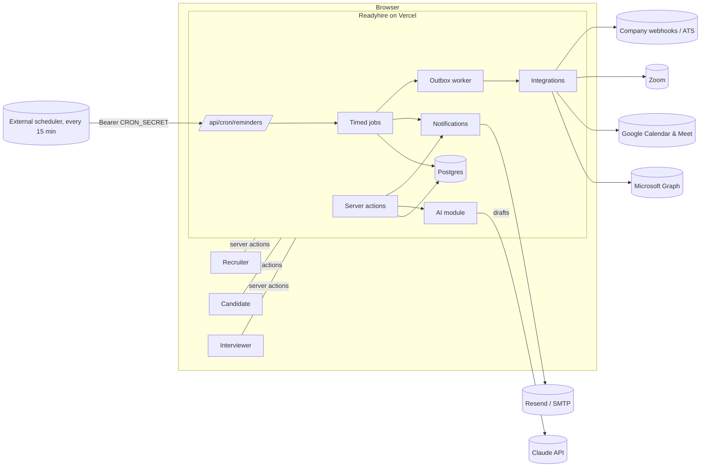
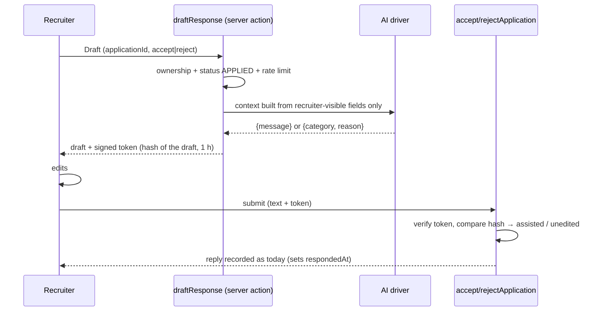
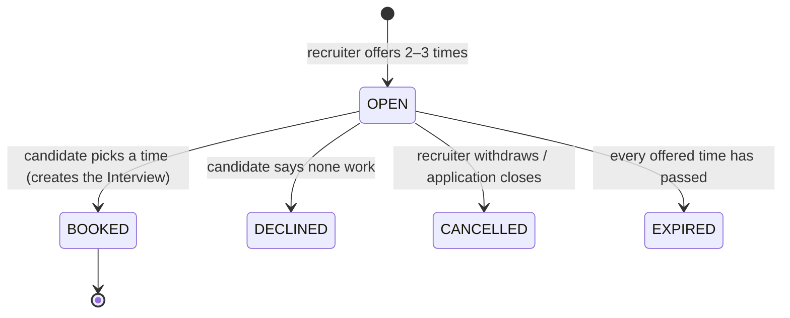

# Hiring coordination: architecture

How Readyhire takes on the recruiter-coordination features from the HireFlow concept (AI-drafted replies, interview
scheduling and reminders, meeting links, panels and feedback, transcripts, ATS sync) without weakening the rules that
make Readyhire what it is.

Status of each phase is tracked at the end of this document.

---

## 1. Goals and non-goals

**Goals**

- Cut the time a recruiter spends on coordination: replying to applications, arranging interviews, reminding people,
  collecting feedback.
- Make Readyhire's existing promises easier to keep, above all _every application gets a reply within 72 hours_.
- Fit GCC hiring teams: Microsoft 365 first, panels of interviewers, an existing ATS.

**Non-goals**

- An autonomous agent that decides or sends on a recruiter's behalf. The assistant drafts and schedules; people decide.
- Replacing the company's ATS. Readyhire stays the system of record for what happens on Readyhire and sends updates out.
- Ranking or scoring candidates with AI. Drafts and summaries only; no automated screening.

## 2. Rules every feature must follow

These come straight from the conflicts identified when comparing HireFlow with Readyhire. They are invariants: code
review should reject a change that breaks one.

| #   | Rule                                                                                                                                                                                           | Where it's enforced                                                                |
| --- | ---------------------------------------------------------------------------------------------------------------------------------------------------------------------------------------------- | ---------------------------------------------------------------------------------- |
| R1  | **Readyhire is the source of truth** for application status, the response deadline, commitment, offers and joining outcomes. External systems receive updates; they don't overwrite them.      | Server actions only; integrations are outbound (phase 6)                           |
| R2  | **Only a recruiter's own submission counts as the reply.** AI drafts, automatic acknowledgements and reminders never set `respondedAt`.                                                        | `acceptApplication` / `rejectApplication` remain the only writers of `respondedAt` |
| R3  | **Reject reasons stay specific.** An AI draft is a starting point; unchanged drafts are recorded so admins can see them.                                                                       | `responseDraftUnedited` on the application (phase 1)                               |
| R4  | **No personal data in third-party artefacts.** Calendar invites, `.ics` files and meeting titles carry the role and a link into Readyhire, never the candidate's contact details or documents. | Invite/ICS builders (phases 2 and 3)                                               |
| R5  | **Offers are recorded in Readyhire** in every flow, so offer counts stay accurate.                                                                                                             | `extendOffer` stays the only path; integrations never create offers                |
| R6  | **Every automated step re-checks state first**: application still open, account active, candidate not restricted. A stale invite or reminder must fail closed.                                 | Each action and job re-reads state inside its transaction                          |
| R7  | **AI sees only what the recruiter can already see** at that stage, and the privacy policy says an AI provider processes it.                                                                    | `src/lib/ai/context.ts` builds the only input the model ever gets                  |
| R8  | **Recording and transcription need the candidate's consent**, and declining has no effect on the application.                                                                                  | Consent captured per interview (phase 5)                                           |

## 3. Where we start from

What already exists and is reused:

| Building block                                    | Today                                                     | Reused for                                                  |
| ------------------------------------------------- | --------------------------------------------------------- | ----------------------------------------------------------- |
| Server actions + `ActionForm`                     | All writes go through typed, validated server actions     | Every new action                                            |
| `ApplicationEvent` timeline + `AuditLog`          | Per-application activity; admin decisions                 | Logging assisted replies, invites, bookings                 |
| `notify` + `after()`                              | Emails sent after the response, never blocking the action | All new emails                                              |
| `/api/cron/reminders` (bearer-token protected)    | 72-hour reply reminders, cleanup                          | Becomes the single scheduler entry point for all timed work |
| `signPayload` / `verifyPayload`                   | Signed upload tickets                                     | Draft tokens, OAuth state                                   |
| Storage drivers (local, S3/R2)                    | Private documents and resumes                             | Transcripts (phase 5)                                       |
| Driver pattern (`EMAIL_DRIVER`, `STORAGE_DRIVER`) | Swappable providers, a local default for dev/test         | `AI_DRIVER`, meeting providers                              |

What does not exist yet: any AI, calendar or meeting integration; interviewers other than the job's recruiter;
interview reminders; time-zone-aware calendar files.

## 4. System overview



### 4.1 Cross-cutting components

**AI module (`src/lib/ai/`)**, phase 1, reused in phase 5.

- `AI_DRIVER=anthropic | template | off`. `template` gives deterministic drafts with no network (local development and
  tests); `off` hides AI features. Default: `template` in development and test, `off` in production until configured.
- The `anthropic` driver uses the official `@anthropic-ai/sdk` with:
  - model `claude-opus-5-5` (override with `AI_MODEL`), effort `low` (override with `AI_EFFORT`): short drafting
    doesn't need more;
  - structured output (`output_config.format`, JSON Schema) so a draft is always `{message}` or `{category, reason}`,
    validated again with Zod;
  - server-side refusal fallback (`fallbacks: "default"`), and `stop_reason: "refusal"` handled before reading content;
  - a 30-second timeout and one retry, because a recruiter is waiting on the button.
- `context.ts` is the only place model input is assembled, from fields the recruiter can already see (R7): the job, the
  candidate's headline, title, experience, skills, city, verified joining timeline, active-offer count and cover note.
  Never email, phone, documents or resume files.
- Every call is recorded in `AiRequest` (purpose, model, token counts, outcome) for cost tracking, and drafting is rate
  limited per recruiter.
- Rough cost: about 1.5K input and 1K output tokens (including thinking) per draft, roughly **US$0.02 per draft** at
  current Opus 5.5 prices. Measure with `AiRequest` before changing model or effort.

**Scheduler.** One entry point, `GET /api/cron/reminders`, protected by `Authorization: Bearer $CRON_SECRET`.

- It runs each timed job in turn: reply reminders, interview reminders, invite expiry, then (later) feedback chasing,
  the outbox and retention.
- Every job is **idempotent and window-based**: it acts on rows whose time has come and records when it acted, so
  running it more often never double-sends, and missing a run only delays.
- Vercel Hobby allows one cron run a day, which is too coarse for "2 hours before". Production should call the endpoint
  **every 15 minutes from an external scheduler** (cron-job.org or similar, free) with the bearer header. The daily
  Vercel cron stays as a backstop. Vercel Pro (hourly cron) also works.

**Outbox (`OutboundJob` table)**, phase 3 onwards.

- Calls to external APIs (create a Teams meeting, cancel it, post a webhook) are written as jobs in the same
  transaction as the change that needs them, then executed by the scheduler with retries and backoff.
- This keeps user actions fast, survives provider outages, and makes every external effect traceable.

**Token vault (`src/lib/crypto.ts`)**, phase 3.

- OAuth refresh and access tokens are encrypted with AES-256-GCM using `TOKEN_ENCRYPTION_KEY` (32 random bytes,
  base64) before they reach the database.
- Keys can be rotated with a `keyVersion` column.

## 5. Phases

### Phase 1: response assistant

**Problem.** The 72-hour reply rule is Readyhire's core promise and the main source of recruiter effort.

**What the user sees.**

- On an application waiting for a reply, **Draft with AI** buttons sit above the accept message and the reject reason.
- The draft fills the field. The recruiter edits it and sends it with the existing buttons.
- The reject draft also proposes a rejection category, which the recruiter can change.
- A note under the field: _"AI draft. Review it before sending; only what you send counts as your reply."_
- An earlier reminder: recruiters now get one email when 48 hours are left, as well as the existing 24-hours-left
  reminder and the overdue alert.

**Flow.**



**Data model.**

```prisma
model Application {
  // …existing fields…
  earlyReminderSentAt   DateTime? // 48-hours-left reminder
  responseDraftUsed     Boolean   @default(false) // the reply started from an AI draft
  responseDraftUnedited Boolean   @default(false) // …and was sent without changes
}

model AiRequest {
  id           String   @id @default(cuid())
  userId       String?
  purpose      String   // "response-draft:accept", "response-draft:reject", later "scorecard-draft"
  model        String
  inputTokens  Int      @default(0)
  outputTokens Int      @default(0)
  outcome      String   // "ok" | "refused" | "error"
  createdAt    DateTime @default(now())
  @@index([createdAt])
}
```

**Security and rules.**

- R2: the draft action never writes the application.
- R3: `responseDraftUnedited` is shown to admins on the applications page.
- R7: the context builder is unit-tested to exclude email, phone and documents.
- The draft token is signed, tied to the application and the draft's hash, and expires after an hour. A forged or
  stale token only loses the "assisted" flags; it can't change the reply.

**Config.**

- `AI_DRIVER`, `ANTHROPIC_API_KEY`, `AI_MODEL`, `AI_EFFORT`.
- Production configuration checks require `ANTHROPIC_API_KEY` when `AI_DRIVER=anthropic`.

### Phase 2: candidate-picked interview slots and reminders

**Problem.** Agreeing a time takes several emails; candidates and panels forget interviews.

**What the user sees.**

- _Recruiter_, in "Next step": **Offer interview times** with the round, duration, mode, location or link, notes, and
  2–3 date/time options. Scheduling a single fixed time stays available.
- _Candidate_: a "Pick an interview time" card on the application page and the dashboard, plus an email.
  - One click books the slot; the interview is then scheduled and already confirmed.
  - **None of these work** sends a note back to the recruiter.
- _Both_, on every interview:
  - an **Add to calendar** link (an `.ics` file that works with Outlook, Google and Apple calendars, with no
    integration needed);
  - email reminders 24 hours and 2 hours before.

**Flow.**



**Data model.**

```prisma
enum InterviewInviteStatus { OPEN BOOKED DECLINED CANCELLED EXPIRED }

model InterviewInvite {
  id            String                @id @default(cuid())
  applicationId String
  application   Application           @relation(fields: [applicationId], references: [id], onDelete: Cascade)
  round         String
  durationMins  Int
  mode          InterviewMode
  location      String?
  notes         String?
  status        InterviewInviteStatus @default(OPEN)
  declineNote   String?
  createdAt     DateTime              @default(now())
  updatedAt     DateTime              @updatedAt
  slots         InterviewInviteSlot[]
  interview     Interview?            // set when booked
  @@index([applicationId, status])
}

model InterviewInviteSlot {
  id       String          @id @default(cuid())
  inviteId String
  invite   InterviewInvite @relation(fields: [inviteId], references: [id], onDelete: Cascade)
  startsAt DateTime
  @@unique([inviteId, startsAt])
}

model Interview {
  // …existing fields…
  inviteId          String?          @unique
  invite            InterviewInvite? @relation(fields: [inviteId], references: [id])
  reminder24hSentAt DateTime?
  reminder2hSentAt  DateTime?
}
```

**Rules.**

- Booking is a **conditional update** (`status = OPEN` in the `WHERE`), so a double click or two tabs can't book twice.
- R6: booking re-checks that the application is still `ACCEPTED`/`INTERVIEWING` and that the slot is in the future.
- Rejecting or withdrawing an application cancels its open invites, as it already cancels scheduled interviews.
- R4: the `.ics` file and the reminder emails carry the role, company, time, mode and the location the recruiter
  entered, plus a link into Readyhire. They never include contact details or documents.
- The `.ics` route is authenticated: only the candidate and the job's recruiter (later, its panel) can download it.

**Reminder windows**, run by the scheduler; each is sent at most once:

| Reminder | Sent when                                    | To                      |
| -------- | -------------------------------------------- | ----------------------- |
| 24 hours | `scheduledAt − 24h ≤ now < scheduledAt − 2h` | Candidate and recruiter |
| 2 hours  | `scheduledAt − 2h ≤ now < scheduledAt`       | Candidate and recruiter |

If the scheduler only runs daily, the 24-hour reminder still works (sent up to 24 hours early); the 2-hour reminder
needs the 15-minute schedule described in §4.1.

### Phase 3: calendars and meeting links (Teams first, then Google Meet, then Zoom)

**What changes.**

- A recruiter connects their calendar under **Account → Integrations**. Readyhire can then:
  - show the recruiter's (later the panel's) busy times when offering slots;
  - create the meeting with a real join link when an interview is booked;
  - update or cancel the meeting when the interview changes.
- Manual links keep working.

**Provider interface.**

```ts
interface MeetingProvider {
  id: "microsoft" | "google" | "zoom";
  authorizeUrl(state: string): string; // OAuth 2.0 + PKCE
  exchangeCode(code: string, verifier: string): Promise<Tokens>;
  busy(conn: Connection, from: Date, to: Date): Promise<Interval[]>;
  createMeeting(conn: Connection, input: MeetingInput): Promise<{ providerMeetingId: string; joinUrl: string }>;
  updateMeeting(conn: Connection, id: string, input: MeetingInput): Promise<void>;
  cancelMeeting(conn: Connection, id: string): Promise<void>;
  transcript?(conn: Connection, id: string): Promise<Transcript | null>; // phase 5
}
```

| Provider              | Create meeting                                                                             | Busy times                                | Notes                                                                                                      |
| --------------------- | ------------------------------------------------------------------------------------------ | ----------------------------------------- | ---------------------------------------------------------------------------------------------------------- |
| Microsoft 365 / Teams | Graph: calendar event with `isOnlineMeeting` and `onlineMeetingProvider: teamsForBusiness` | Graph `getSchedule`                       | Most GCC tenants need **admin consent** for the app; publish a consent link and documentation for their IT |
| Google Meet           | Calendar API event with `conferenceData.createRequest` (`hangoutsMeet`)                    | Calendar `freeBusy`                       | Calendar scopes require Google's app verification                                                          |
| Zoom                  | Zoom Meetings API `POST /users/me/meetings`                                                | Not provided; use the calendar connection | A Zoom Marketplace app                                                                                     |

**Data model.**

```prisma
enum IntegrationProvider { MICROSOFT GOOGLE ZOOM }

model CalendarConnection {
  id              String              @id @default(cuid())
  userId          String
  user            User                @relation(fields: [userId], references: [id], onDelete: Cascade)
  provider        IntegrationProvider
  accountEmail    String
  accessTokenEnc  String
  refreshTokenEnc String
  expiresAt       DateTime
  scopes          String
  keyVersion      Int                 @default(1)
  createdAt       DateTime            @default(now())
  updatedAt       DateTime            @updatedAt
  @@unique([userId, provider])
}

model OutboundJob {
  id             String    @id @default(cuid())
  kind           String    // "meeting.create", "meeting.cancel", "webhook.deliver", …
  payload        Json
  idempotencyKey String    @unique
  attempts       Int       @default(0)
  nextRunAt      DateTime  @default(now())
  lastError      String?
  doneAt         DateTime?
  createdAt      DateTime  @default(now())
  @@index([doneAt, nextRunAt])
}

model Interview {
  // …
  meetingProvider   IntegrationProvider?
  providerMeetingId String?
  joinUrl           String?
}
```

**Security.**

- Least-privilege scopes: calendar events for the signed-in user only; no mail scopes.
- OAuth state is signed (`signPayload`) and bound to the user, and PKCE is used.
- Tokens are encrypted at rest (§4.1). Disconnecting deletes the tokens and revokes them at the provider.

**Prerequisites (owner).** Register the Microsoft Entra app, the Google Cloud OAuth client (and verification) and the
Zoom app; add `TOKEN_ENCRYPTION_KEY` and each provider's client ID and secret to Vercel.

### Phase 4: company team members, panels and scorecards

**What changes.**

- An approved recruiter invites colleagues by email. Invitations are limited to the company's verified email domain.
- Each colleague gets a role:
  - `RECRUITER`: today's recruiter role;
  - `HIRING_MANAGER`: can see the company's applications and decide alongside the recruiter;
  - `INTERVIEWER`: sees only the interviews they're on.
- Interviews get a **panel**. After each interview, panelists fill a **scorecard**: a rating from 1 to 5, a
  recommendation and notes.
- Late scorecards are chased automatically (24 and 48 hours after the interview), then escalated to the recruiter, as
  in HireFlow.

**Decisions.**

- Invited members of an already-approved company domain don't need a second admin approval, but they're listed on the
  admin Recruiters page and can be restricted there.
- The **application decision stays with the recruiter** (R2): scorecards inform it, they don't make it.

**Data model (outline).**

- `RecruiterProfile.teamRole` (`RECRUITER | HIRING_MANAGER | INTERVIEWER`)
- `TeamInvite`: email, role, token hash, expiry
- `InterviewPanelist`: interviewId, recruiterProfileId
- `Scorecard`: interviewId, recruiterProfileId, rating, recommendation, notes, submittedAt, reminder timestamps

### Phase 5: transcripts and draft scorecards

**What changes.**

- **Consent:** when an interview is booked, the candidate is asked whether it may be recorded and transcribed.
  - `Interview.transcriptConsent`: `GRANTED | DECLINED | null`, plus a timestamp.
  - Declining changes nothing else (R8).
- **Fetching:** after the meeting, the outbox asks the provider for the transcript (phase 3's `transcript()`) and stores
  it in private storage under `transcripts/…`.
- **Access:** only the recruiter and that interview's panel can open it.
- **Retention:** transcripts are deleted after `TRANSCRIPT_RETENTION_DAYS` (default 90) by the scheduler.
- **Draft scorecard:** panelists can ask for a draft scorecard from the transcript. It is a draft (R2/R3) and is
  recorded in `AiRequest`.

**Prerequisites.**

- Meeting plans with transcription turned on.
- Provider permissions for transcripts:
  - Microsoft Graph's transcript APIs need extra tenant consent and may need approval or licensing;
  - Google Meet needs the Meet API on a supported Workspace edition;
  - Zoom needs cloud recording with audio transcripts.
- Confirm each provider's current terms before building.

### Phase 6: ATS sync

**What changes.**

- Companies register **webhook endpoints**: a URL plus a signing secret shown once.
- Readyhire posts signed events (`application.created`, `application.status_changed`, `interview.scheduled`,
  `interview.completed`, `offer.extended`, `joining.recorded`) through the outbox, with retries and a delivery log.
- This works with any ATS or integration platform the company already uses (Workday Studio, Greenhouse Harvest via
  middleware, Zapier, Power Automate).
- Native connectors for specific ATSs come later, on demand. They stay **outbound first** (R1); any inbound change is
  limited to fields Readyhire doesn't own.

## 6. Configuration summary

| Variable                                                                         | Phase    | Purpose                                                                        |
| -------------------------------------------------------------------------------- | -------- | ------------------------------------------------------------------------------ |
| `AI_DRIVER`                                                                      | 1        | `anthropic`, `template` or `off`                                               |
| `ANTHROPIC_API_KEY`                                                              | 1        | Claude API key (required when `AI_DRIVER=anthropic`)                           |
| `AI_MODEL`, `AI_EFFORT`                                                          | 1        | Default `claude-opus-5-5`, `low`                                               |
| `CRON_SECRET`                                                                    | existing | Bearer token for the scheduler (also used by the external 15-minute scheduler) |
| `TOKEN_ENCRYPTION_KEY`                                                           | 3        | 32-byte base64 key for OAuth tokens                                            |
| `MICROSOFT_CLIENT_ID/SECRET`, `GOOGLE_CLIENT_ID/SECRET`, `ZOOM_CLIENT_ID/SECRET` | 3        | Provider apps                                                                  |
| `TRANSCRIPT_RETENTION_DAYS`                                                      | 5        | Default 90                                                                     |

## 7. Testing strategy

- **Unit** (Vitest):
  - the AI context builder (allowed fields only) and output validation;
  - the Anthropic driver, against a mocked `fetch`, covering the request shape, refusals and malformed output;
  - reminder-window maths;
  - slot validation;
  - `.ics` generation;
  - token encryption round-trip;
  - webhook signing.
- **End-to-end** (Playwright, `AI_DRIVER=template`, console email outbox):
  - draft → edit → send (assisted and unedited flags);
  - offer times → candidate picks → interview booked and confirmed, with the calendar file downloadable by the right
    people only;
  - "none of these work";
  - the scheduler sends 24-hour and 2-hour reminders exactly once.
- **Providers** (phases 3, 5 and 6): contract tests against recorded provider responses; a manual checklist against a
  sandbox tenant before enabling each provider in production.

## 8. Rollout and status

| Phase                          | Can be built now?                                                          | Status      |
| ------------------------------ | -------------------------------------------------------------------------- | ----------- |
| 1. Response assistant          | Yes. Needs an Anthropic API key to switch on in production.                | In progress |
| 2. Slots and reminders         | Yes. Needs the 15-minute scheduler for 2-hour reminders.                   | Next        |
| 3. Calendars and meeting links | Code yes; switching on needs the provider app registrations and approvals. | Designed    |
| 4. Team members and scorecards | Yes                                                                        | Designed    |
| 5. Transcripts                 | Needs phase 3, paid meeting plans and provider transcript permissions      | Designed    |
| 6. ATS webhooks                | Yes                                                                        | Designed    |

Before phase 1 goes live:

- move email to your own domain (Resend);
- update the privacy policy (done in phase 1);
- set `AI_DRIVER=anthropic` and `ANTHROPIC_API_KEY` in Vercel.
